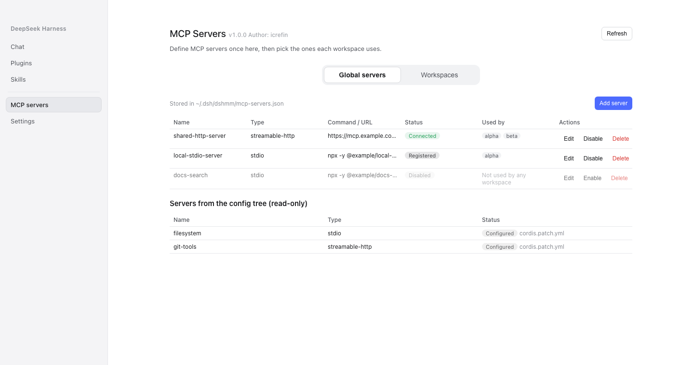
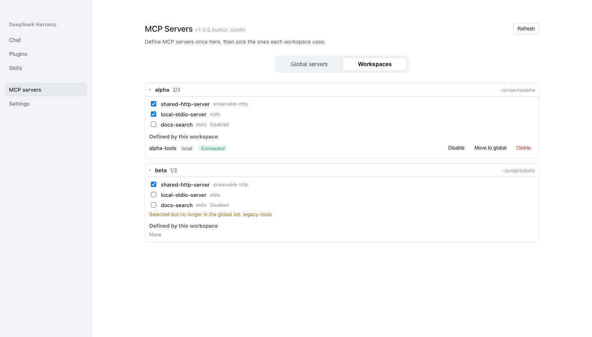

# dsh-mcp-mgr

**One MCP registry for the whole profile** — declare an MCP server once, choose it per workspace, and manage every server from a panel in the DeepSeek Harness sidebar.

**English** | [简体中文](README.zh-CN.md)

[](LICENSE)
[](https://github.com/icrefin/dsh-mcp-mgr/releases)
[](https://github.com/icrefin/dsh-mcp-mgr/actions/workflows/ci.yml)
[](https://github.com/icrefin/dsh-mcp-mgr/commits/main)
[](https://github.com/icrefin/dsh-mcp-mgr/stargazers)
[](https://github.com/icrefin/dsh-mcp-mgr/pulls)
[](https://nodejs.org)
[](https://github.com/deepseek-ai/deepseek-harness)

> If this plugin saves you a round of hand-editing JSON, a ⭐ star helps the next person find it.

## Why this exists

MCP servers are declared per workspace, so the same server description gets copied into every workspace file that needs it — and drifts. This plugin splits the two questions that were tangled together:

| Question | Where it is answered now |
|---|---|
| *What servers exist?* | once, in a profile-scoped registry |
| *Which ones does this workspace use?* | a `use` list in that workspace's file |

Servers move between the two files without translation, both stay hand-editable, and a workspace that never adopts the plugin keeps working exactly as before: a missing `use` means its inline `mcpServers` mount as they always did.

## Screenshots



*Global servers — add, edit, delete, enable or disable a server, with the profile-level `mcp-client` registrations shown as read-only rows.*



*Workspaces — which global servers each workspace selects, plus its own local servers, dangling references and parse errors.*

## The two files

```
<profile>/.dsh/dshmm/mcp-servers.json     every server definition, shared
<workspace>/.dsh/dshmm/mcp.json           `use: [...]` selects from it,
                                          and may still declare inline servers
```

A selected global server mounts once for the whole profile; inline servers mount per workspace. Strict mode mounts only the active workspace's servers.

## Features

| Surface | What it does |
|---|---|
| Sidebar row | sits directly under **Plugins** (`order: 1`) and opens the **MCP Servers** page in the centre column |
| Global servers tab | the registry: add / edit / delete / enable a server, plus the profile-level `mcp-client` registrations as read-only rows |
| Workspaces tab | per-workspace selection as checkboxes, each workspace's own local servers, dangling references, parse errors |
| JSON editing | paste a whole `mcpServers` object or one server's JSON; the host validates it and reports per-entry errors |
| Bulk import | import several servers at once, answering its own report |
| Tools | servers are registered through `mcp-client`; workspace tools use the `mcp__<serverName>__<tool>` convention |
| Panel polish | optimistic selection toggles, a 60-second background refresh, tab and scroll position preserved across reloads, and a version chip carrying the installed plugin version |

## Requirements

- Node.js `^22.19.0 || >=24.0.0`
- A DeepSeek Harness `0.2.1-rc.5` installation (the plugin composes into a profile)
- `pnpm` 11.20.0 (`packageManager` in the root manifest pins it)

## Installation

Build both packages, pack them and hand them to the profile:

```sh
pnpm install
pnpm check                        # typecheck → build → verify, both packages
sh tools/install-into-profile.sh desktop
```

Restart DeepSeek Harness afterwards; the sidebar entry appears directly under **Plugins**.

There are two packages, and both are Loader rows of their own:

| Package | Role |
|---|---|
| `dsh-mcp-mgr` | the host half: the registry, the sync layer, and the `mcpMgr` Typert Remote contract |
| `dsh-mcp-mgr-ui` | the browser half: the sidebar row and the page it opens |

Installing the host alone leaves the sidebar row without the page it opens, so the two are built and installed together. The packages are not on npm: the profile installs them from this repository.

`dsh plugin` (a pnpm passthrough into the profile directory) is what the script uses; the Plugins page does the same thing. The desktop profile is owned by the Electron application, so `dsh --profile desktop` itself refuses to compose it, while `dsh plugin` still works.

## Quick start

1. Open **MCP Servers** in the sidebar.
2. On **Global servers**, add a server — by form or by pasting JSON:

   ```json
   {
     "shared-http-server": {
       "type": "http",
       "url": "https://mcp.example.com/mcp"
     }
   }
   ```

3. Switch to **Workspaces** and tick that server for the workspaces that should see it.
4. Restart, or let the panel's refresh confirm the new snapshot; the server's tools appear as `mcp__shared-http-server__*`.

## Configuration

Rules that apply to either file:

- a missing `type` is treated as Streamable HTTP; `${VAR}` expansion is supported;
- a stdio server without `cwd` uses the workspace root;
- `serverName` must match `^[A-Za-z0-9_-]{1,32}$` and is globally unique — duplicates surface as conflicts;
- `"enabled": false` disables an entry without removing it; absent means enabled.

The profile registry is created on the first save from the panel. Neither file has to be created by hand.

## Remote surface

Fourteen methods on the `mcpMgr` namespace, declared once in `src/typert.descriptors.ts` and wrapped as the host manifest and the browser contribution, so the two faces cannot disagree about a wire name or a codec:

| Method | Purpose |
|---|---|
| `version` | this package's installed version, for the title chip |
| `snapshot` | the whole management view |
| `setStrictMode` · `setActiveWorkspace` | gateway state, answering the refreshed snapshot |
| `apply` · `removeServer` · `setServerEnabled` | workspace-local servers |
| `saveGlobalServer` · `saveGlobalServerJson` · `removeGlobalServer` · `setGlobalServerEnabled` | the global registry |
| `setWorkspaceSelection` · `importLocalServer` | which servers a workspace selects |
| `importJson` | bulk import, answering its own report |

## Caveats

- **"Connected" means the tools are registered** (`mcp__<name>__*` present in the tool registry), not that the network is live. `mcp-client` exposes no live connection state, so a real disconnect cannot be detected without changing dsh itself. A connection that drops keeps its last tool generation and reconnects with backoff.
- **The refresh button re-reads the host's last snapshot**; it does not probe.
- The plugin polls no registry and offers no self-update: the panel shows its installed version, and updating means rebuilding and reinstalling it here.

## License and attribution

MIT — see [LICENSE](LICENSE). The host and UI packages derive from `dsh-mcp-mgr` 0.2.0 by **yangfch3** (MIT); that copyright line is kept in the LICENSE file, and this repository is an independent, source-built rewrite rather than a vendored copy of the published bundle.

The panel registers into the same slots dsh's own pages use (`sidebar.panellist` and `main`), and follows the platform's `STYLES.md` contract for page geometry and the version chip.

> Stars are how small projects survive. If this one earned yours, tap ⭐ — it costs nothing and helps someone else find it.
